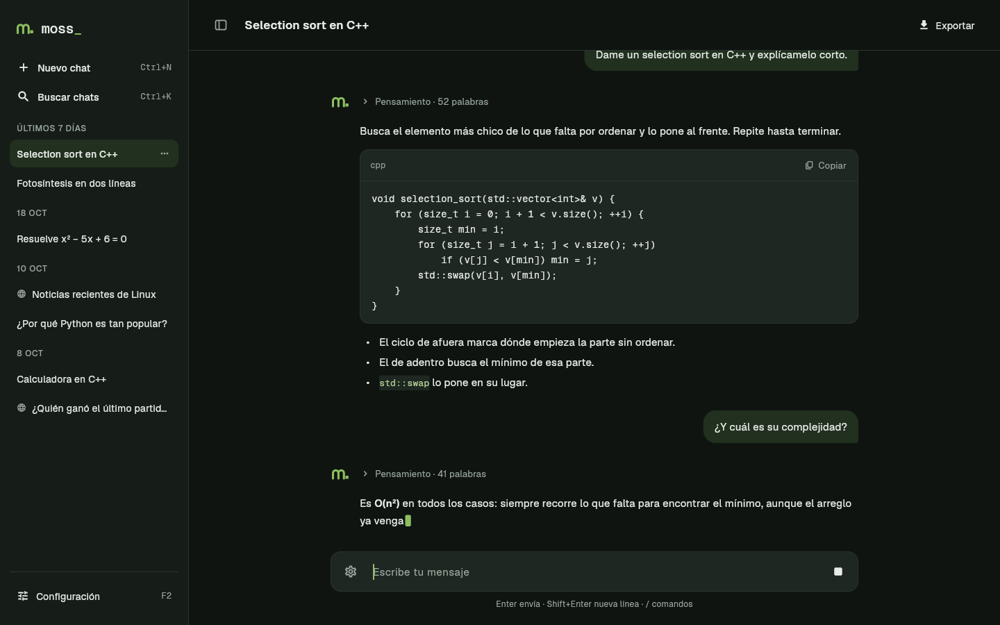
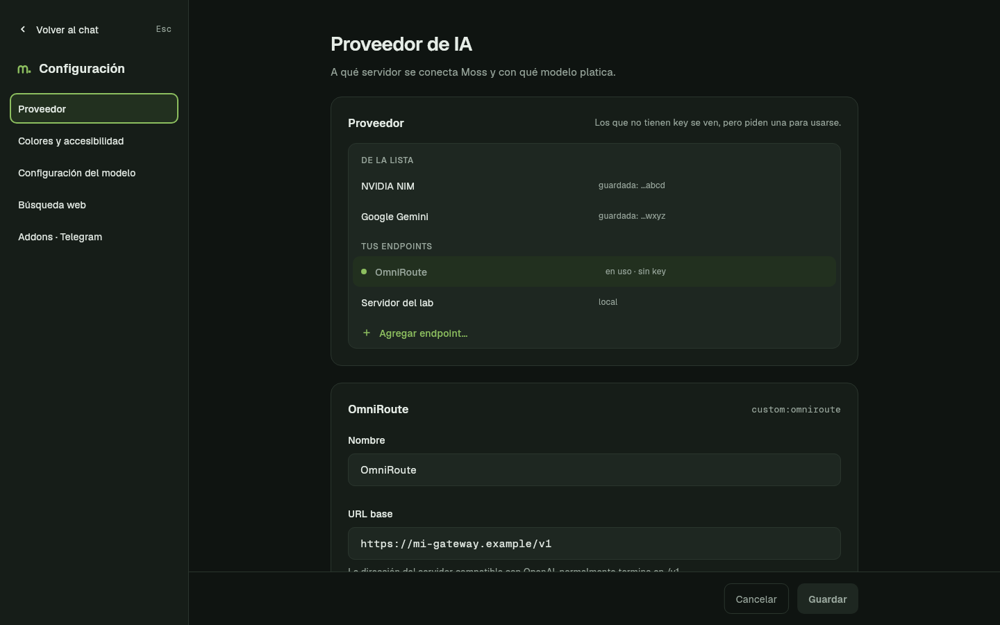

<p align="center"></p>

# Moss

[](https://github.com/Ricky182771/moss/actions/workflows/ci.yml)

Moss es un asistente con el que platicas por escrito, como en un chat, en una ventana o en la terminal. Lo hacen estudiantes de CECyTE como servicio social.

## Qué hace

Moss se conecta al proveedor de inteligencia artificial que tú elijas, con cualquier API compatible con OpenAI, y guarda tus chats en tu computadora. **Necesitas tu propia API key** (por ejemplo, la del plan gratuito de NVIDIA NIM) o un servidor local como Ollama: Moss no trae ninguna.

- Proveedores: NVIDIA NIM, Google Gemini, OpenRouter, OpenAI y otros de una lista, servidores locales (Ollama, llama.cpp) y endpoints propios.
- Interfaz gráfica (`moss-gui`) y de terminal (`moss`), con los mismos chats y la misma configuración.
- Pensamiento visible: el razonamiento del modelo, plegable, aparte de la respuesta.
- Búsqueda web con `/buscar`, que responde citando sus fuentes (con una key de [Tavily](https://tavily.com)).
- Bot de Telegram para la escuela (solo Linux).

<p align="center">
  
  
</p>

## Descargas

Bájalo de la página de [releases](https://github.com/Ricky182771/moss/releases):

| Sistema | Archivo |
|---|---|
| Windows 10 u 11 (64 bits) | `moss-<versión>-windows-x64.zip` |
| Fedora | `moss-<versión>-1.x86_64.rpm` |
| Debian 12, Ubuntu 22.04 o más nuevos | `moss_<versión>-1_amd64.deb` |
| Otro Linux x86_64 | `moss-<versión>-linux-x86_64.tar.gz` |

- **Windows:** descomprime el ZIP y abre `moss-gui.exe`.
- **Fedora:** `sudo dnf install ./moss-<versión>-1.x86_64.rpm`
- **Debian o Ubuntu:** `sudo apt install ./moss_<versión>-1_amd64.deb`
- **Otro Linux:** `tar -xzf moss-<versión>-linux-x86_64.tar.gz && ./moss-<versión>/moss-gui`

`SHA256SUMS` trae la suma de cada archivo. Los binarios de Windows todavía no están firmados: ver [Code signing policy](#code-signing-policy). Qué hacer con SmartScreen y el Control Inteligente de Aplicaciones, el modo portable (escuelas, memoria USB) y cómo desinstalar: [guias/instalar.md](guias/instalar.md).

## Compilar

Necesitas CMake 3.21 o posterior, Ninja, GCC o Clang con C++20, libcurl, nlohmann/json y `git` (la primera vez CMake descarga FTXUI y md4c); para la interfaz gráfica, además, [Flutter](https://docs.flutter.dev/get-started/install/linux) 3.47.9 y GTK 3. En Fedora:

```bash
sudo dnf install gcc-c++ cmake ninja-build libcurl-devel json-devel git
sudo dnf install clang pkgconf-pkg-config gtk3-devel xz-devel   # solo para la GUI
```

Terminal (`moss`) y RPC (`moss-rpc`), en `build/release/cli/`:

```bash
git clone https://github.com/Ricky182771/moss.git
cd moss
cmake --preset release && cmake --build --preset release
./build/release/cli/moss
```

Interfaz gráfica, desde la misma carpeta (busca `moss-rpc` junto a su ejecutable, o donde diga `--rpc`):

```bash
(cd gui && flutter pub get && flutter build linux --release)
gui/build/linux/x64/release/bundle/moss-gui --rpc="$PWD/build/release/cli/moss-rpc"
```

Ubuntu y Debian, Windows (MSYS2), los demás presets y las pruebas: [guias/11-compilacion.md](guias/11-compilacion.md). La GUI en desarrollo y en Windows: [gui/README.md](gui/README.md).

## Documentación

- [Usar Moss en la terminal](guias/uso.md): teclas, comandos, `/model`, copiar y exportar.
- [Configurar](guias/configurar.md): proveedores, keys, endpoints, colores, búsqueda web, modo portable.
- [Instalar](guias/instalar.md): Windows y Linux, paso a paso.
- [Bot de Telegram](guias/telegram.md): crearlo, configurarlo y autorizar a los alumnos.
- [Interfaz gráfica](gui/README.md) y su [diseño](gui/diseno/DISENO.md).
- [Protocolo de `moss-rpc`](rpc/PROTOCOL.md): para hacer otra interfaz.
- [Empaquetado y releases](guias/17-empaquetado.md).
- Contribuir: [reglas del proyecto](AGENTS.md) y [compilación y pruebas](guias/11-compilacion.md).

## Privacidad

Moss no manda información a ningún otro sistema salvo lo que el usuario pide: los mensajes van al proveedor de IA que él configura, y la búsqueda web y el bot de Telegram solo si los activa. No hay telemetría. Tres detalles:

- Al abrir F2 en la terminal o Configuración en la ventana, si ya pusiste la URL y la key, Moss le pide al mismo proveedor la lista de sus modelos. No manda ningún mensaje tuyo.
- Mientras el bot de Telegram está activo, le pregunta a Telegram todo el tiempo si llegaron mensajes nuevos. Si lo apagas, deja de hacerlo.
- La búsqueda web no tiene un interruptor aparte: se usa solo cuando escribes `/buscar` y tienes una key de búsqueda guardada. Sin key, no se manda nada.

Qué se manda a Tavily: [Búsqueda web](guias/configurar.md#búsqueda-web). Qué guarda el bot: [Bot de Telegram](guias/telegram.md).

## Code signing policy

The Windows binaries are not signed yet. We have applied to SignPath Foundation for free code signing.

Only binaries built from this repository by GitHub Actions (`release.yml`) would be signed.

- Authors: [Ricky182771](https://github.com/Ricky182771)
- Reviewers: [Ricky182771](https://github.com/Ricky182771)
- Approvers: [Ricky182771](https://github.com/Ricky182771)

Privacy: Moss sends nothing to any other system except what the user asks for; there is no telemetry. See [Privacidad](#privacidad).

## Licencia

Moss se distribuye bajo la GPL v3 o, a tu elección, cualquier versión posterior (GPL-3.0-or-later); ver [LICENSE](LICENSE). Los paquetes traen `AVISOS-TERCEROS.txt` con las licencias de las bibliotecas que incluyen ([cómo se genera](guias/17-empaquetado.md#avisos-tercerostxt)).
